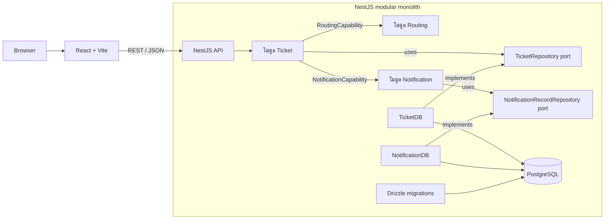

# support-ticket

## Purpose

แอปจัดการ Ticket ฝ่ายสนับสนุนลูกค้าสำหรับพิสูจน์แนวคิด - ผู้ใช้สร้าง เรียกดู และเปลี่ยนสถานะ Ticket ได้ ระบบกำหนดทีมรับผิดชอบจากหมวดหมู่และความสำคัญ พร้อมบันทึก Notification เมื่อสร้าง Ticket

โปรเจกต์นี้สาธิตสถาปัตยกรรม Modular Monolith ร่วมกับ Clean Architecture โดยแบ่งระบบเป็น Module ตามความรับผิดชอบ และจัดโค้ดภายในแต่ละ Module เป็น layer ดังนี้:

- **Presentation (`http/`):** เป็น controllers รับและตรวจสอบ HTTP requests แล้วแปลงผลลัพธ์เป็น HTTP responses
- **Application (`application/`):** รวม use cases และประสานงานระหว่าง business rules กับ repository
- **Domain (`domain/`):** เก็บ business models, rules
- **Infrastructure (`infrastructure/`):** เชื่อมต่อระบบภายนอกและ implement persistence adapters เช่น Drizzle กับ PostgreSQL

## Technology

- **Frontend:** React, TypeScript, Vite, TanStack Query, React Hook Form, Zod
- **Backend:** NestJS, TypeScript, Swagger
- **Database:** PostgreSQL 17, Drizzle ORM
- **Tests:** Vitest, Supertest
- **Local runtime:** Docker Compose

### เหตุผลที่เลือก

- เนื่องจาก NestJS มีโครงสร้างแบบ Modular และรองรับ Dependency Injection ช่วยแยกความรับผิดชอบและกำหนดขอบเขตของ Business Modules ได้ชัดเจน เหมาะกับการออกแบบ Modular Monolith โดยสามารถเชื่อมต่อโมดูลผ่าน Contracts และแยก Business Logic ออกจากกันตามแนวคิด Clean Architecture ทำให้ระบบทดสอบ บำรุงรักษา และขยายต่อได้ง่าย

## Architecture

React เรียก NestJS API โดยตรง โมดูล Backend สื่อสารกันภายใน process ผ่าน capability และ repository contract



### Project structure

```text
backend/src/
├── app.module.ts                 # ประกอบโมดูล Backend
├── db/                           # การเชื่อมต่อ PostgreSQL, Drizzle schema และ migrations
└── modules/
    ├── ticket/
    │   ├── domain/               # กฎ การตรวจสอบข้อมูล และการเปลี่ยนสถานะ Ticket
    │   ├── application/          # use case สำหรับสร้าง ดูรายการ ดูข้อมูล และเปลี่ยนสถานะ;
    │   │                         # TicketRepository contract
    │   ├── http/                 # TicketController และ request DTO
    │   └── infrastructure/       # DrizzleTicketRepository และตัว seed ข้อมูลเมื่อเริ่มระบบ
    ├── routing/
    │   ├── domain/               # กฎกำหนดทีมจากหมวดหมู่และความสำคัญ
    │   ├── application/          # use case DetermineTeam
    │   └── contracts/            # RoutingCapability ที่ Ticket เรียกใช้
    └── notification/
        ├── application/          # RecordNotification, ListNotifications และ
        │                         # NotificationRecordRepository contract
        ├── contracts/            # NotificationCapability ที่ Ticket เรียกใช้
        ├── http/                 # NotificationController และ query DTO
        └── infrastructure/       # DrizzleNotificationRepository

frontend/src/
├── app/                          # Providers, dashboard shell และ state ที่ใช้ร่วมกันข้าม feature
├── features/
│   ├── tickets/                  # ฟอร์ม รายการ รายละเอียด ตัวกรอง และการเปลี่ยนสถานะ Ticket
│   └── notifications/            # แสดง Notification
├── shared/                       # API client, pagination และ UI ที่ใช้ร่วมกัน
└── style.css                     # สไตล์ของแอป
```

**ความรับผิดชอบของแต่ละ Module**

- **Ticket:** บันทึก, เรียกดู และอัพเดตสถานะของ Ticket
- **Routing:** กำหนดทีมรับผิดชอบตามหมวดหมู่และความสำคัญ
- **Notification:** บันทึกและเรียกดู Notification records


## Setup

```sh
# ไม่บังคับ: คัดลอกค่าเริ่มต้น แล้วแก้ไขค่าใน .env
cp .env.example .env

docker compose up --build -d
```

Compose จะเริ่ม PostgreSQL, migration service แบบทำงานครั้งเดียว, Backend และ Vite frontend โดย Backend จะเริ่มหลังฐานข้อมูลพร้อมใช้งานหลัง migrations ทำงานเสร็จแล้ว หากตาราง Ticket ยังว่าง จะสร้าง Ticket ตัวอย่าง 5 รายการพร้อม Notification records เมื่อเริ่ม Backend ใหม่จะไม่ seed ซ้ำหากมี Ticket อยู่แล้ว

เปิดใช้งาน:

- Dashboard: <http://localhost:5173>
- API base: <http://localhost:3000/api/v1>
- Swagger UI: <http://localhost:3000/api/docs>
- Health: <http://localhost:3000/health>


### Environment variables `.env`:

| Variable | Default | Purpose |
| --- | --- | --- |
| `POSTGRES_PASSWORD` | `support_ticket` | รหัสผ่าน PostgreSQL สำหรับเครื่อง local |
| `VITE_API_URL` | `http://localhost:3000` | Origin ของ Backend |
| `CORS_ORIGIN` | `http://localhost:5173,http://127.0.0.1:5173` | รายการ origin ของ frontend |

## API endpoints

Business endpoints ใช้ prefix `/api/v1` ยกเว้น `/health`

| Method | Endpoint | Purpose |
| --- | --- | --- |
| `POST` | `/api/v1/tickets` | สร้าง Ticket; body มี `title`, `description`, `category` และ `priority` |
| `GET` | `/api/v1/tickets?page=1&limit=5` | แสดงรายการ Ticket; กรองด้วย `status` และ `category` ได้ |
| `GET` | `/api/v1/tickets/{id}` | ดู Ticket รายการเดียว |
| `PATCH` | `/api/v1/tickets/{id}/status` | เปลี่ยนสถานะด้วย `{"status":"IN_PROGRESS"}` หรือ `{"status":"RESOLVED"}` |
| `GET` | `/api/v1/notifications?page=1&limit=5` | แสดงรายการ Notification records |
| `GET` | `/health` | ตรวจสอบสถานะ Backend |


### ค่าที่รองรับ

- **หมวดหมู่ Ticket:** `TECHNICAL`, `BILLING`, `GENERAL`
- **ระดับความสำคัญ:** `LOW`, `MEDIUM`, `HIGH`, `CRITICAL`
- **รหัสทีม (`TEAM_CODES`):** `INCIDENT_TEAM`, `ENGINEERING_TEAM`, `FINANCE_TEAM`, `SUPPORT_TEAM`
- **สถานะ:** Ticket เริ่มที่ `OPEN` และเปลี่ยนได้ตามลำดับ `OPEN` → `IN_PROGRESS` → `RESOLVED` เท่านั้น ไม่อนุญาตให้ข้ามขั้นหรือย้อนกลับ

### นโยบายกำหนดทีม

ตรวจสอบ `priority` ก่อน `category` หากเป็น `CRITICAL` จะกำหนด `INCIDENT_TEAM` โดยไม่ขึ้นกับหมวดหมู่:

| เงื่อนไข | ทีมที่ได้รับมอบหมาย |
| --- | --- |
| `category = TECHNICAL` | `ENGINEERING_TEAM` |
| `category = BILLING` | `FINANCE_TEAM` |
| `category = GENERAL` | `SUPPORT_TEAM` |

**เหตุผล:** ที่กำหนดให้ Ticket ที่มี Priority เป็น CRITICAL ส่งไปยัง INCIDENT_TEAM ก่อน โดยจำลองแนวคิดที่เหตุการณ์รุนแรงต้องได้รับการประสานงานอย่างเร่งด่วน


## AI-Assisted Development

เริ่มจากใช้ ChatGPT ช่วยหาไอเดียและรวบรวม Requirements เบื้องต้น ก่อนสรุปเป็น spec ที่ระบุเป้าหมาย ขอบเขต และสถาปัตยกรรมเป็น spec คร่าวๆ ([`docs/spec.md`](docs/spec.md)) จากนั้นใช้ AI coding agent: Pi (Oh My Pi) กับโมเดล GPT-6 Sol และ Luna + Agent skills เพื่อวางแผน แบ่งงาน และพัฒนาโปรเจกต์ตามแนวทาง Spec-Driven Development โดยมี flow ดังนี้:

- **`grill-me-with-docs`** - ใช้ทบทวน Requirements ด้วยคำถามเพื่อค้นหาข้อกำหนดที่ยังไม่ชัดเจน พร้อมพิจารณาทางเลือกและ trade-offs ก่อนกำหนด scope สำหรับ spec
- **`to-spec`** - แปลง Requirements เป็น Technical Specification ครอบคลุม Architecture, Module Boundaries และ Acceptance Criteria
- **`to-tickets`** - แบ่ง spec ออกเป็น Tasks ย่อยๆ ที่มีขอบเขตชัดเจนและลำดับการทำงาน โดยจะเก็บเป็น Issues ที่ [`/.scratch`](/.scratch)
- **`implement-spec`** - ใช้คู่กับคำสั่ง `orchestrate` ให้ Main Agent กระจาย Tickets ไปยัง Subagents ทำงานบน Integration Branch โดยทุกตัวจะ implement เป็น TDD และรวมผลลัพธ์สุดท้ายกลับมา

จากนั้นจะสั่งให้ตรวจสอบ Implementation เปรียบเทียบกับ Spec ว่าถูกต้องมั้ย, แล้วลองทดสอบ, และใช้สกิล `to-retro` ช่วยรีวิวและหาส่วนที่ต้องปรับปรุง จากนั้นก็ refactor case by case

## Limitations

โปรเจกต์นี้เป็น proof of concept: ไม่มี Authentication หรือ Authorization, ไม่มีการส่ง Notification โดยใช้ email หรือ sms service ภายนอก.
