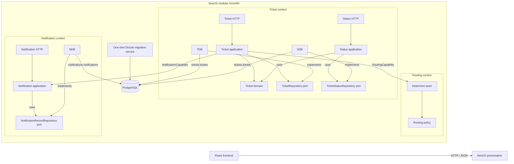

# Architecture

## Shape

The app is a React frontend backed by one NestJS process. Ticket, Routing, and Notification are the three business contexts. Ticket Status is a submodule of Ticket, not a fourth business context. Internal capabilities are in-process contracts, not HTTP calls.

The frontend calls business endpoints under `/api/v1`; health is `/health`. Swagger UI and its generated OpenAPI JSON are `/api/docs` and `/api/docs-json`. Compose runs `db`, `migrate`, `backend`, and `frontend`; the backend waits for database health and successful migration. Compose publishes frontend and API on `127.0.0.1:8080` and `127.0.0.1:3000`.

## Frontend feature layout

`main.tsx` mounts the app. `app/` owns providers, the dashboard shell, selected-ticket coordination, and cache invalidation across features. `features/tickets/` owns ticket validation and types, API calls, the create form, browsing, details, and status actions. `features/notifications/` owns notification retrieval and its dashboard panel. Existing global styles remain in `style.css`; there is no `shared/` module until both features need the same code.

## Business contexts and contracts

- **Ticket** owns ticket lifecycle, validation and status transitions, ticket HTTP endpoints, and `tickets.tickets`. Its application layer handles create, list, retrieve, and status update use cases. `TicketRepository` and `TicketStatusRepository` are ports; Drizzle adapters map persistence records to domain objects.
- **Routing** owns deterministic category/priority team assignment. `RoutingCapability.determineTeam({ category, priority })` returns `{ teamCode, reason }`. Critical priority overrides category. Routing has no database table and must not read or write Ticket tables.
- **Notification** owns notification records, retrieval, and `notifications.notifications`. `NotificationCapability.recordTicketCreated({ ticketId, title, assignedTeamCode })` records a creation notification; it does not send a message. Notification keeps a logical ticket ID and does not query Ticket tables or use a cross-context foreign key.

Ticket composition calls Routing through `ROUTING_CAPABILITY` and Notification through `NOTIFICATION_CAPABILITY`, both exported by their owning Nest modules. Ticket persists before it attempts notification recording. Notification recording is best-effort: failure is logged and does not undo the committed ticket. There is no transactional outbox or retry worker; a crash can omit a record.

## Dependency boundaries

Domain and application code use plain TypeScript types and contracts. NestJS controllers/DI are presentation/composition concerns. Drizzle and PostgreSQL access belong in infrastructure adapters. `DatabaseModule` supplies the connection pool; repositories own Drizzle queries and mapping.

Manual, repeatable inspection for this repository:

1. Inspect `backend/src/modules/ticket/domain/` and `backend/src/modules/ticket/application/`. Confirm there are no NestJS, Drizzle, or database imports; the use cases depend on repository and capability contracts.
2. Inspect `backend/src/modules/routing/` and `backend/src/modules/notification/` for references to Ticket persistence. Confirm neither context imports the Ticket table/repository or accesses `tickets.tickets`. Notification stores only a logical ticket ID.
3. Inspect `backend/src/modules/ticket/ticket.module.ts` and the capability contract files. Confirm Nest binds the contract tokens to providers at composition, instead of the business use case depending on concrete Routing/Notification infrastructure.

These are source-inspection steps, not an automated dependency-boundary test. Ticket Status currently has its own repository adapter in `ticket/infrastructure/`; it operates on Ticket-owned state.

## Limits

This is a proof of concept: no authentication/authorization, external notification delivery, durable delivery guarantee, or public deployment hardening. Compose's loopback binding limits this local demo's published ports to the host; it does not make public exposure safe. Add authentication/authorization and deployment security controls before any public deployment.
